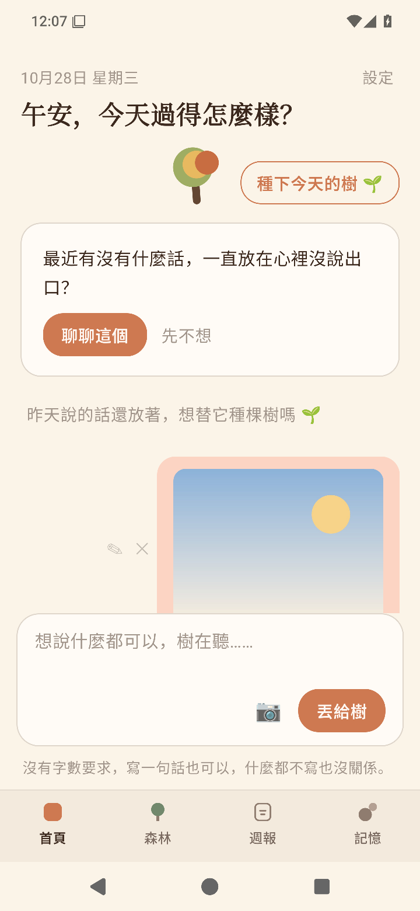
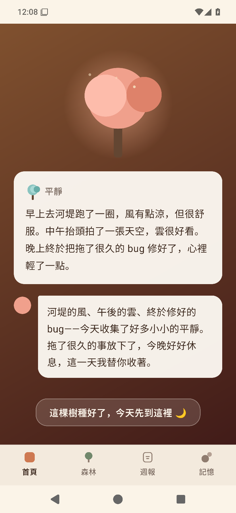
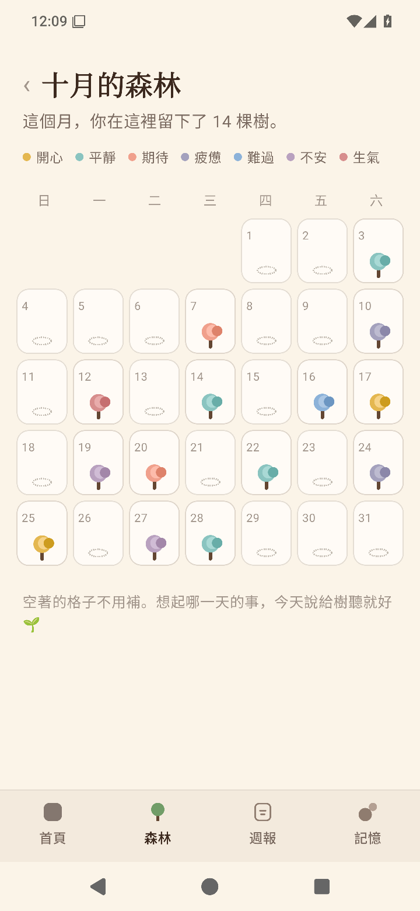
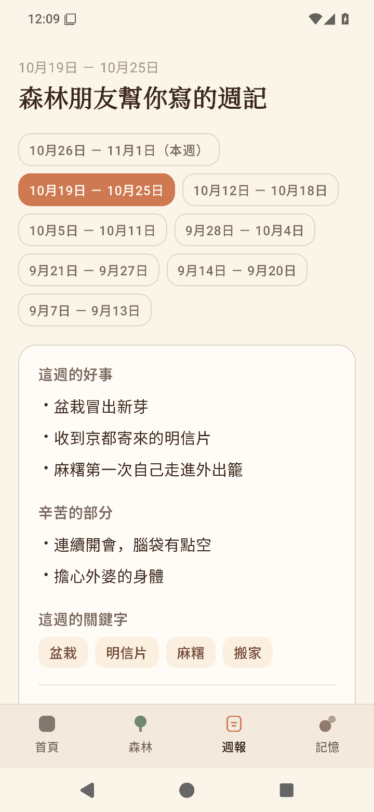
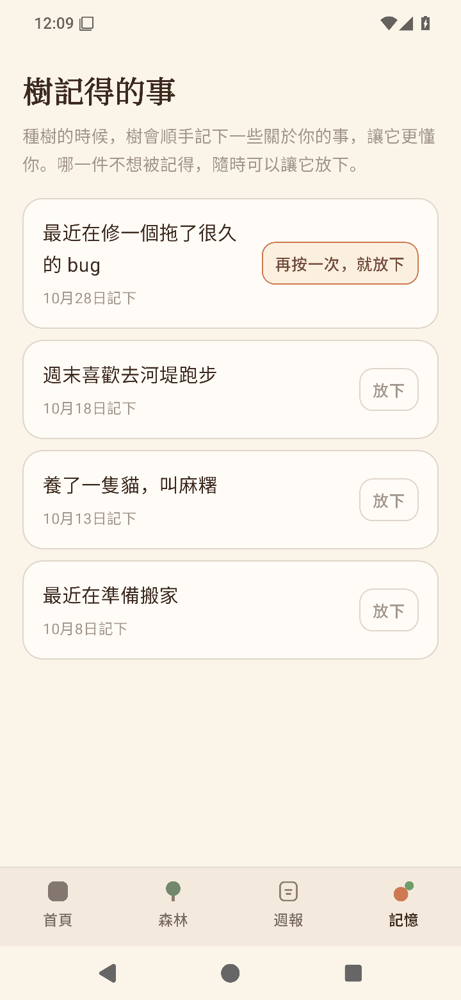
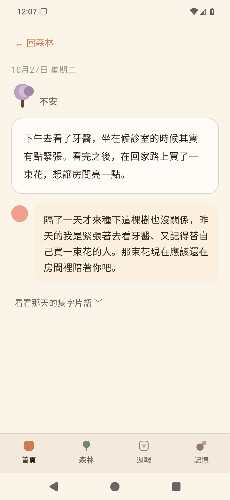
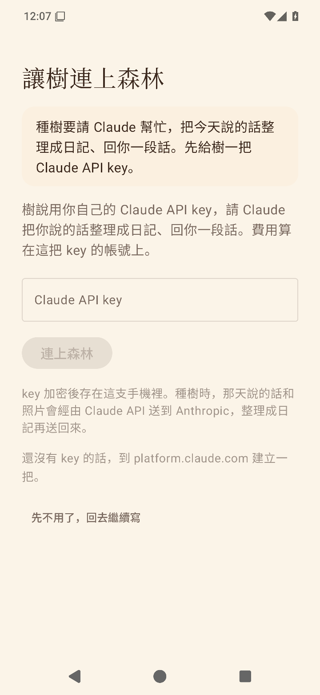
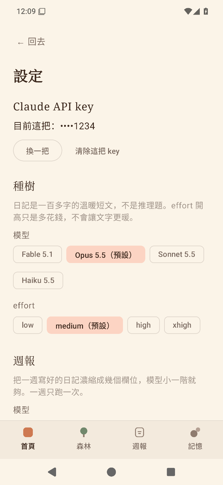

# 樹說（TreeSay）🌳

[](https://www.python.org/)
[](https://fastapi.tiangolo.com/)
[](https://www.sqlite.org/)
[](https://vuejs.org/)
[](https://www.typescriptlang.org/)
[](https://kotlinlang.org/)
[](https://developer.android.com/)

[](https://platform.claude.com/)

單人本機、無登入的療癒日記 App。像傳訊息一樣把想法丟給「樹」，
AI 整理成日記並溫暖回覆。

有網頁版，也有 [Android 版](#手機版android)。

命名取「訴說」諧音——把心事說給樹聽。

**核心定位：一個安靜聽你說、替你把一天收好的傾聽者。**

白天把碎片隨手丟給樹，晚上按一個鍵，它替你長成一篇日記——

「做了很多，但說不出今天做了什麼」的那種日子，就是它想接住的東西。

不評價、不打分、不算連續天數。


## 這個 App 怎麼運作

- **今日**——白天隨手丟訊息，晚上按「種下今天的樹」，AI 一次整理成日記、判定情緒、寫下回覆
- **森林**——月曆檢視，每一天是一棵依情緒長成的樹
- **週報**——已結束的一週可生成回顧，當週顯示「這週還在生長中」
- **記憶**——樹長期記著一些關於你的事，讓回覆接得上前面的日子；每一條你都看得到、刪得掉

那天忘記按「種下今天的樹」也沒關係：那些話不會消失，森林上會留一道淡淡的土壤痕跡，
點進去看得到自己說過什麼，**48 小時內（昨天、前天）還能把那棵樹補種下去**。

再更早的日子就過期了——訊息一樣讀得到，只是不會再長出樹來。

這個窗口刻意留得短。有些日子就是沒有收尾，那也沒關係；如果每一天都能回頭填滿，
森林就變成一張要交的作業，而不是真的發生過什麼。

## 畫面

| 今日 | 森林 |
|---|---|
|  |  |

| 週報 | 記憶 |
|---|---|
|  |  |

首頁的樹會隨風輕擺、偶爾有小東西來訪，也會跟著真實季節與入夜換樣貌。這些只是「它在這裡」，不反映你說了多少、心情如何。畫面要不要動由側邊欄底部的「動態」決定：開（預設）、關、跟系統；選擇記在這個瀏覽器裡。

手機版的畫面見[手機版（Android）](#手機版android)。

## 前置需求

> [!IMPORTANT]
> 這個專案透過 Claude API 生成日記與週報，**需要你自己的 Anthropic API key，按用量計費**。
> key 只放在你自己電腦上的 `.env`，程式只綁 `127.0.0.1`——它是給自己用的，不適合部署成公開服務。

| 需求 | 版本 | 說明 |
|---|---|---|
| Python | 3.13+ | 後端 |
| Node.js | >=24.12 | 前端 build |
| Anthropic API key | — | 到 [Claude Console](https://platform.claude.com/) 建立，需先儲值 |

在專案根目錄建立 `.env`（已在 `.gitignore`，不會進版控），填入 key：

```bash
cp .env.example .env && chmod 600 .env
# 打開 .env，填 TREESAY_ANTHROPIC_API_KEY=sk-ant-...
```

`.env` 只在 `python main.py` 啟動時讀取，改了要重新啟動。也可以改用 shell 的
`export TREESAY_ANTHROPIC_API_KEY=...`——shell 裡已有的值優先，`.env` 不會覆蓋它。

> [!NOTE]
> 刻意不用 `ANTHROPIC_API_KEY`：那個變數一旦 export，Claude Code 也會讀到它，
> 從訂閱改走 API 計費。樹說用自己的變數名，兩邊互不干擾。

早期版本透過本機 `claude` CLI 走 Claude Code 的訂閱額度，最後一版是 commit [`17dae6a`](https://github.com/twtrubiks/treesay/tree/17dae6a)，
已不再維護，只留在 git 歷史裡。

## 安裝

```bash
git clone https://github.com/twtrubiks/treesay && cd treesay

# 後端
python -m venv .venv && source .venv/bin/activate
pip install -r backend/requirements.txt

# 前端（build 一次即可，之後啟動不需要 Node）
cd frontend && npm install && npm run build && cd ..
```

## 啟動

```bash
cd backend && python main.py
```

打開 http://127.0.0.1:8000 就是完整的 App——後端會直接提供前端頁面，
不需要另外啟動 dev server。

啟動時若沒有設定 `TREESAY_ANTHROPIC_API_KEY`，終端機會提示；此時仍可瀏覽既有日記，
只是種樹與週報會失敗。

## 你的資料在哪

> [!IMPORTANT]
> **「本機」指的是儲存，不是 AI。** 日記與照片只存在你的磁碟上，沒有帳號、
> 沒有伺服器保管、沒有其他使用者看得到。但按下「種下今天的樹」或產生週報時，
> 當天的訊息／日記內容與照片會經由 Claude API **送到 Anthropic** 才生成回覆，
> 適用 Anthropic 商業條款（API）的資料政策——依官方文件，API 資料未經你明確同意
> 不會用來訓練模型。
>
> 也就是說：不會有別人讀到你的日記，但它不是完全不出門。要連這段都留在本機，
> 得改接本機模型（目前不支援）。

日記預設存在 `~/.treesay/`：

```
~/.treesay/
├── treesay.db     # 所有日記與週報
└── photos/        # 訊息附的相片
```

可用環境變數改變落點：

```bash
TREESAY_DATA_DIR=/path/to/somewhere python main.py
```

## 花多少錢

AI 按 Claude API 用量計費，**一天一次種樹，一週一次週報**。側邊欄底部的「AI 費用」頁
（手機版在「設定」裡）會按月顯示估算花費，實際帳單以 [Claude Console](https://platform.claude.com/) 為準。

以預設檔次實測（2026 年 10 月）：

| 一次呼叫 | 費用 |
|---|---|
| 種樹（不附照片） | 約 US$0.02 |
| 種樹時每多附一張照片 | 約 US$0.006 |
| 週報 | 約 US$0.004 |

每天種樹、不附照片，一個月約 US$0.5～0.7；每天附兩張照片約 US$1。
照片送出前會縮到標準解析度（原圖不動），不縮的話一張就要 US$0.019，幾乎等於一次種樹。

預設檔次：種樹用 `claude-opus-5-5`、週報用 `claude-sonnet-5-5`，effort 都是 `medium`。

**想再省一點**：一次種樹的費用裡，模型的思考佔了近四成，使用者的訊息本身只佔零頭，
所以降 effort 比少說話有效。由省到更省：

```bash
TREESAY_PLANT_EFFORT=low            # 種樹少想一點；日記是短文不是推理題，影響有限
TREESAY_WEEKLY_MODEL=claude-haiku-5-5   # 週報只是濃縮已寫好的日記，小模型就夠
TREESAY_PLANT_MODEL=claude-sonnet-5-5   # 種樹換小一階的模型，單價減半
```

effort 可填 `low`、`medium`、`high`、`xhigh`。這些變數寫進 `.env` 就固定下來
（`.env.example` 裡有註解掉的範本），或在啟動時臨時帶入。啟動時終端機會印一行
實際生效的檔次（`🌳 AI 檔次：plant=... / ...`）；effort 打錯字會退回預設並提醒，
不會變成種樹失敗。

**備份**——日記是不可再生的資料。完整匯出：

```bash
curl -OJ http://127.0.0.1:8000/api/export     # 存成 treesay-YYYYMMDD.json
```

也可以直接用瀏覽器開 `/api/export` 下載。相片不含在 JSON 裡（只記檔名），
完整備份請連同 `~/.treesay/photos/` 一起複製。

換電腦或重灌之後，把匯出的 JSON 匯回來：

```bash
curl -F "file=@treesay-YYYYMMDD.json" http://127.0.0.1:8000/api/import
```

匯入只加不蓋：本機已經有的那一天、那一週、同一條記憶會跳過，不會被匯入的版本覆蓋。
動筆前會先把整個資料庫複製成 `~/.treesay/treesay.db.bak-<時間>`，匯壞了把它改回
`treesay.db` 就回到匯入前。相片請自己把 `photos/` 複製回去，檔名對得上就會重新顯示。

## 手機版（Android）

[`android/`](android/) 是原生的 Android App（Kotlin ＋ Jetpack Compose，Android 9 以上）。
不用開電腦，路上想到什麼就丟給樹；今日、種樹、森林、補種、週報、記憶、AI 費用、匯出匯入都有。

| 首頁 | 種下之後 | 森林 | 週報 |
|---|---|---|---|
|  |  |  |  |

| 記憶 | 補種昨天 | 種樹時才要 key | 設定 |
|---|---|---|---|
|  |  |  |  |

截圖是 CI 在 Android 16 模擬器上跑展示流程時拍的，日記內容是測試資料。

### 跟網頁版一樣的地方

規則照搬網頁版，兩邊有測試盯著：

- 白天只收集，按「種下今天的樹」才呼叫一次 AI；凌晨 4:00 換日；忘了種的那天 48 小時內可以補種
- 記憶的界線一樣：只用來理解你，不追蹤進度、不對帳；每一條都看得到、刪得掉
- prompt、JSON schema、今日問題的題庫逐字相同。網頁版改了 prompt，Android 的測試會失敗提醒
- 預設檔次一樣（種樹 `claude-opus-5-5`、週報 `claude-sonnet-5-5`，effort 都是 `medium`）
- 「本機」一樣只涵蓋儲存：日記存在手機上，但種樹與週報時，那天的話與照片會送到 Anthropic

### 不一樣的地方

| | 網頁版 | 手機版 |
|---|---|---|
| 怎麼跑 | 在自己電腦上跑後端，瀏覽器開 `127.0.0.1:8000` | 裝 APK，手機自己呼叫 Claude API，不需要電腦 |
| API key | 寫在 `.env` 的 `TREESAY_ANTHROPIC_API_KEY` | 在 App 裡貼上，先試一次打得開門，再用 Android Keystore 加密存在手機。沒有 key 也能先寫，第一次按「種下今天的樹」時才要 |
| 模型與 effort | 環境變數（`TREESAY_PLANT_MODEL` 等） | 「設定」裡直接選 |
| 設定、AI 費用、畫面動態 | 側邊欄底部的小字 | 首頁右上角的「設定」 |
| 日記存在哪 | `~/.treesay/` | 手機上 App 自己的資料夾，其他 App 讀不到；關掉了 Android 的雲端備份，不會備份到 Google 雲端硬碟 |
| 備份 | `curl` 打 `/api/export`、`/api/import` | 「設定」→「匯出日記」／「匯入」，用系統的存檔與開檔畫面 |
| 照片 | 上傳檔案 | 系統的照片挑選器；手機拍的 HEIC 送出前轉成 JPEG |
| 種樹 | 開著頁面等它長好 | 在背景種，切走 App、關掉螢幕也會種完 |
| 出國 | 時間存電腦的本地時間 | 時間連時差一起存，訊息顯示說話當地的時間，換日照當地的凌晨 4:00 |

> [!WARNING]
> **移除 App 會連日記一起刪掉。** 要移除、換手機，或從下載的版本改裝自己 build 的 APK（簽章不同，得先移除舊版）之前，
> 先到「設定」匯出一份。

### 手機和電腦之間搬日記

兩邊各存各的，不會自動同步。匯出的 JSON 格式相同，可以互相匯入：手機匯出、電腦用
`curl -F "file=@treesay-YYYYMMDD.json" http://127.0.0.1:8000/api/import` 匯入，反過來也行。
一樣只加不蓋：另一邊已經有的那一天、那一週、同一條記憶會保留原樣。照片不在 JSON 裡，只記檔名。

### 安裝 APK

**[⬇️ 下載最新版 treesay.apk](https://github.com/twtrubiks/treesay/releases/latest/download/treesay.apk)**（[所有版本](https://github.com/twtrubiks/treesay/releases)）

用手機打開上面的連結，下載完點開就能安裝；第一次會要你允許瀏覽器「安裝不明來源的應用程式」。

還沒有上架 Google Play，所以安裝時 Google Play 安全防護可能會先掃描一下。

每一版都用同一把金鑰簽名，Release 頁面列了簽章憑證的 SHA-256，可以用來核對。

想自己 build 也可以（需要 JDK 17 以上與 Android SDK）：

```bash
cd android
./gradlew assembleRelease
```

自己 build 的 APK 用你電腦的 debug 金鑰簽名，跟上面下載的版本簽章不同，不能互相直接更新（見上面的提醒）。

Android 版的開發約定、模擬器測試與錄影流程見 [`android/CLAUDE.md`](android/CLAUDE.md)。

## 開發

前端改動想要熱重載時，用 vite dev server（會 proxy `/api` 到後端）：

```bash
cd backend && python main.py         # 後端 :8000
cd frontend && npm run dev           # 前端 :5173，開這個
```

測試：

```bash
pip install -r backend/requirements-dev.txt
cd backend && pytest
```

Android 版的單元測試（從 repo 根目錄）：

```bash
cd android && ./gradlew testDebugUnitTest
```

## 技術棧

- **後端**：FastAPI ＋ SQLAlchemy ＋ SQLite（uvicorn 僅綁 `127.0.0.1`）
- **前端**：Vue 3 ＋ Vite ＋ TypeScript ＋ Pinia
- **AI**：Claude API（官方 `anthropic` SDK，structured outputs）
- **Android**：Kotlin ＋ Jetpack Compose ＋ SQLite，官方 `anthropic-java` SDK，背景種樹用 WorkManager

設計文件見 [`docs/plans/`](docs/plans/)。

## 授權

[MIT](LICENSE)

## Donation

文章都是我自己研究內化後原創，如果有幫助到您，也想鼓勵我的話，歡迎請我喝一杯咖啡 :laughing:

綠界科技ECPAY ( 不需註冊會員 )


[贊助者付款](http://bit.ly/2F7Jrha)

歐付寶 ( 需註冊會員 )


[贊助者付款](https://payment.opay.tw/Broadcaster/Donate/9E47FDEF85ABE383A0F5FC6A218606F8)

## 贊助名單

[贊助名單](https://github.com/twtrubiks/Thank-you-for-donate)
